  

  
  
  

### Hi, I'm Jai 👋

I design, build and ship complete products on my own, from the first screen to the live server. I work with shops, schools, event teams and startups that need something real in production, not a demo.

### Open to

| | |
| --- | --- |
| **Freelance and client projects** | Web apps, dashboards, billing and operations tools, AI features |
| **Product partnerships** | Founders who need a builder who owns design, code and deployment |
| **Remote and full-time roles** | Full-stack or AI engineering, product-minded teams |

> The fastest way to reach me is email: **[iboy.innovationhub@gmail.com](mailto:iboy.innovationhub@gmail.com)**. Tell me what you want to build and by when.

### What I can build for you

|  |  |
| --- | --- |
| **Business apps** | Billing, inventory, ERP and role-based dashboards with Next.js, NestJS and PostgreSQL |
| **AI products** | Assistants, voice and Tamil-language features, RAG and multi-agent workflows |
| **Mobile** | Flutter apps with real-time chat and offline support |
| **3D and interactive web** | React Three Fiber experiences, AI hosts and demos |

### Selected work

| Project | What it is | Status |
| --- | --- | --- |
| **Laabo** | Tamil-first billing, stock and profit platform for shops and supermarkets, with a voice assistant. Client product, developed and licensed by iBOY | Client pilot |
| **Tectovia SMS** | DST-funded school management system with role dashboards and assessments. ₹2.5 lakh grant, live at [tectovia.in](http://tectovia.in/) | In institutional use |
| **[iPetie](https://github.com/iBOYJAI/iPetie)** | Real-time AI pet companion with live chat and admin tools. Flutter, NestJS, Supabase | Beta live |
| **[iSoulSync](https://github.com/iBOYJAI/iSoulSync-FV)** | Emotional AI companion with a four-layer memory and emotion engine | In development |
| **[AI Anchor](https://github.com/iBOYJAI/AI_ANCHOR_V.0)** | 3D, voice-driven event host with React Three Fiber, Django and ElevenLabs | Completed |
| **[Campus-to-Career](https://github.com/iBOYJAI/campus-to-career-placement-platform)** | Placement platform with AI resume-to-job matching | Completed |

### Stack

  

### How I work

- **One owner for everything.** Design, code, database, deployment and fixes all stay with me, so nothing gets lost between teams.
- **Real users first.** I test on real phones and real roles before calling something done.
- **Clear and visible.** You get short updates, working builds to click through and plain-language notes.

### iBOY Innovation Hub

My studio for web, apps, AI and automation, branding and digital marketing. *Innovation isn't just what you do, it's who you are.*

  
  

Based in Tamil Nadu, India · Tamil · Tanglish · English · Available for remote work

