<picture>
  <source media="(prefers-color-scheme: dark)" srcset="assets/header-dark.svg">
  <source media="(prefers-color-scheme: light)" srcset="assets/header-light.svg">
  
</picture>

I design, build and ship complete products on my own, from the first screen to the live server. I work with shops, schools, event teams and startups that need something real in production.

**Currently open to** freelance and client projects, product partnerships, and remote or full-time roles.  
**Best way to reach me:** [iboy.innovationhub@gmail.com](mailto:iboy.innovationhub@gmail.com)

&nbsp;

<picture>
  <source media="(prefers-color-scheme: dark)" srcset="assets/focus-dark.svg">
  <source media="(prefers-color-scheme: light)" srcset="assets/focus-light.svg">
  
</picture>

<picture>
  <source media="(prefers-color-scheme: dark)" srcset="assets/langs-dark.svg">
  <source media="(prefers-color-scheme: light)" srcset="assets/langs-light.svg">
  
</picture>

<picture>
  <source media="(prefers-color-scheme: dark)" srcset="assets/activity-dark.svg">
  <source media="(prefers-color-scheme: light)" srcset="assets/activity-light.svg">
  
</picture>

<picture>
  <source media="(prefers-color-scheme: dark)" srcset="assets/stack-dark.svg">
  <source media="(prefers-color-scheme: light)" srcset="assets/stack-light.svg">
  
</picture>

<a href="mailto:iboy.innovationhub@gmail.com">
<picture>
  <source media="(prefers-color-scheme: dark)" srcset="assets/hire-dark.svg">
  <source media="(prefers-color-scheme: light)" srcset="assets/hire-light.svg">
  
</picture>
</a>

&nbsp;

Tamil Nadu, India · Tamil, Tanglish, English · Available for remote work · Charts use my real GitHub data. Strength ratings are self-assessed.
