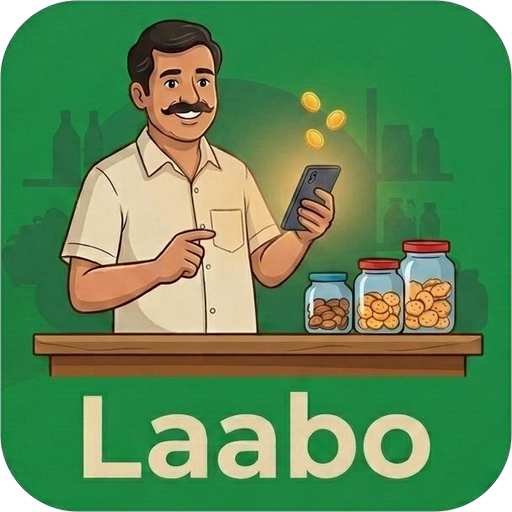
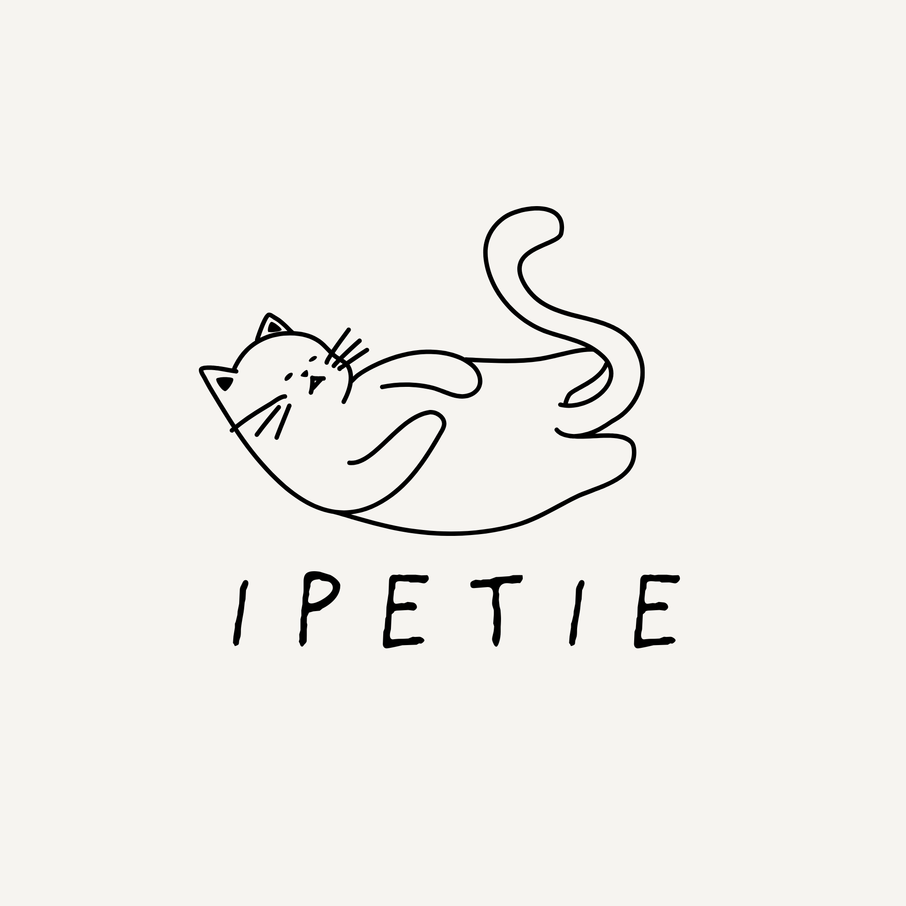

<picture>
  <source media="(prefers-color-scheme: dark)" srcset="assets/header-dark.svg">
  <source media="(prefers-color-scheme: light)" srcset="assets/header-light.svg">
  
</picture>

I design, build and ship complete products on my own, from the first screen to the live server. I work with shops, schools, event teams and startups that need something real in production.

**Currently open to** freelance and client projects, product partnerships, and remote or full-time roles.
**Best way to reach me:** [iboy.innovationhub@gmail.com](mailto:iboy.innovationhub@gmail.com)

&nbsp;

## What I build

- **Business apps:** billing, inventory, ERP and role-based dashboards
- **AI products:** assistants, voice and Tamil-language features, RAG and multi-agent workflows
- **Mobile apps:** Flutter apps with real-time chat and offline support
- **3D and interactive web:** React Three Fiber experiences and AI hosts

&nbsp;

## Products

<table>
  <tr>
    <td width="96" align="center"></td>
    <td><b>Laabo</b> Tamil-first billing, stock and profit platform for shops and supermarkets, with a voice assistant that speaks Tamil, Tanglish and English. Client product, developed and licensed by iBOY. <i>Client pilot.</i></td>
  </tr>
  <tr>
    <td align="center"></td>
    <td><b><a href="https://github.com/iBOYJAI/iPetie">iPetie</a></b> Real-time AI pet companion with live chat rooms and admin tools. Flutter, NestJS, Supabase. <i>Beta live.</i></td>
  </tr>
  <tr>
    <td align="center"></td>
    <td><b><a href="https://github.com/iBOYJAI/iSoulSync-FV">iSoulSync</a></b> Emotional AI companion with a four-layer memory and an emotion engine. NestJS, Next.js, PostgreSQL. <i>In development.</i></td>
  </tr>
</table>

**Also built:**
[Tectovia](http://tectovia.in/), a DST-funded school management system (₹2.5 lakh grant, in institutional use) ·
[AI Anchor](https://github.com/iBOYJAI/AI_ANCHOR_V.0), a 3D voice-driven event host ·
[Campus-to-Career](https://github.com/iBOYJAI/campus-to-career-placement-platform), a placement platform with AI resume matching

&nbsp;

## Tools I use

  
  
  
  
  
  
  
  
  
  
  
  

  
  
  
  
  
  
  
  
  
  
  
  

&nbsp;

## How I work

One owner for design, code, database and deployment, so nothing gets lost between teams. I test on real phones and real user roles before I call something done, and I send short, plain updates with working builds you can click through.

&nbsp;

## Get in touch

Tamil Nadu, India · Tamil, Tanglish, English · Available for remote work
